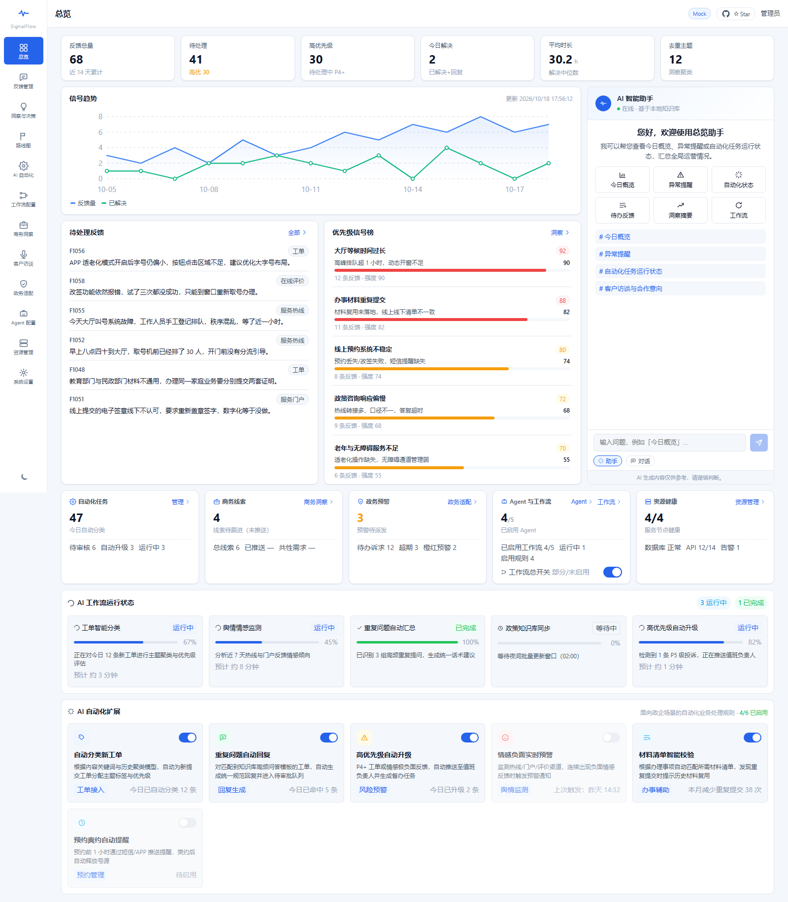
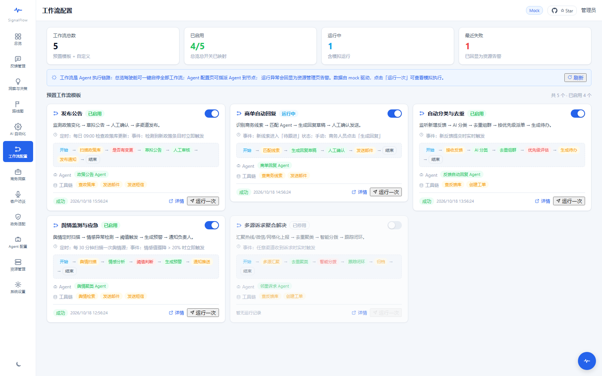
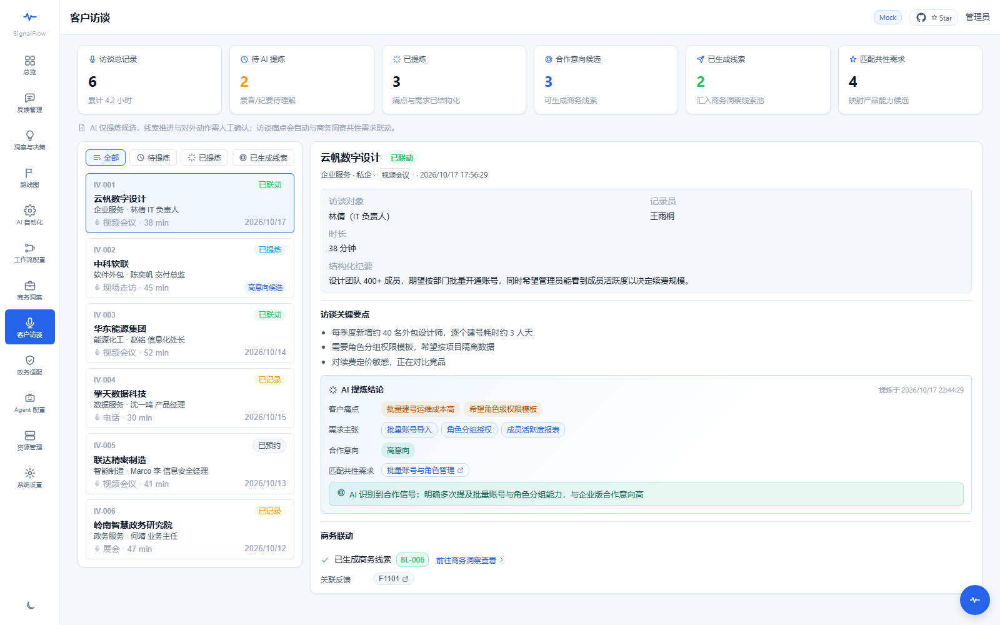
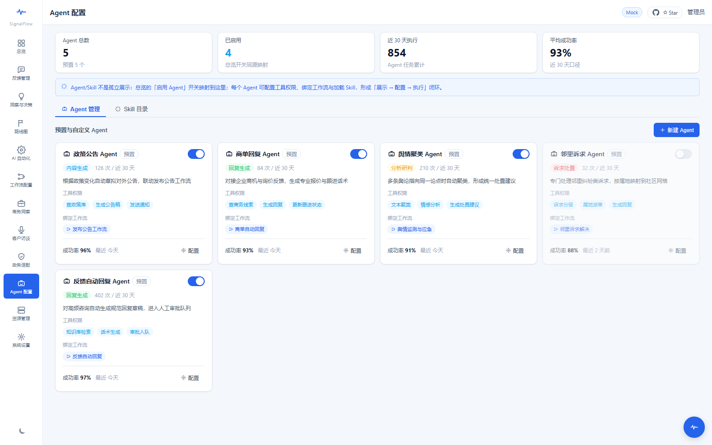

# SignalFlow —— 客户反馈决策工具

> 让每一条客户声音都能被听见、被理解、被行动。

> **授权提示**：本项目源码公开可见，采用自定义授权条款（source-available，非 OSI 开源许可）——个人学习/研究免费，**商业使用与二次开发须事先取得作者授权**，使用时须注明并引用本项目。详见 [`LICENSE`](LICENSE)。

SignalFlow 是一套面向**政企客户**的**反馈收集 → 智能洞察 → 决策行动 → 闭环回传**全链路平台。它将散落在工单系统、销售记录、客户访谈、应用商店评论等多渠道的客户声音汇聚一处，通过 AI 语义分析与工作流编排，帮助产品、客服与客户成功团队在海量反馈中快速定位关键问题、量化客户影响、形成可执行的产品路线，并自动将处置结果回传至客户——全程保留人类最终决策权，确保**AI 辅助而非替代**。

---

## 🎯 解决什么问题

| 痛点 | 传统做法 | SignalFlow 方案 |
|------|---------|----------------|
| **反馈分散** | 工单、邮件、IM、访谈纪要散落在不同系统，无法统一视角 | 多渠道适配器 + 统一反馈事件模型，所有声音汇聚一处 |
| **重复难去重** | 同一问题被反复提交，人工合并耗时且易遗漏 | Embedding 相似度去重 + LangGraph 自动合并，保留原话不丢失 |
| **优先级靠"嗓门"** | 谁投诉多、谁级别高就优先处理，缺乏客观依据 | RICE 思想量化评估（影响面 × 客户价值 × 置信度），打分卡可解释 |
| **决策与行动脱节** | 洞察报告出来后没有直接转化为产品任务或客户回复 | 洞察一键生成路线图项目 + 回复草稿，工作流自动流转 |
| **闭环缺失** | 问题处理了，但客户不知道，感知不到价值 | 审批通过后自动回传状态，客户始终知情 |
| **数据不出域** | 政企客户要求私有化部署，敏感数据不能上云 | 全栈 Docker 化，支持内网部署；LiteLLM 网关支持本地模型 |

**核心价值主张**：把"客户反馈"从成本中心转化为**产品决策的数据资产**——每一条反馈都有迹可循、有理可依、有果可回。

---

## ✨ 设计亮点

### 1. 运营驾驶舱（全局视角，一屏掌控）

总览面板不再只是静态 KPI，而是**实时运营驾驶舱**：
- 自动化任务运行状态、商务线索待跟进数、政务预警待处理数
- Agent / 工作流启用状态、资源健康概况
- AI 智能助手常驻面板，支持「今日概览」「异常提醒」「自动化状态」等快捷指令

### 2. AI 联动闭环（辅助决策，人类兜底）

| 场景 | AI 能力 | 人类介入点 |
|------|--------|-----------|
| 反馈回复 | AI 生成回复草稿，支持人工编辑 | 审批通过/驳回/修改后发送 |
| 自动审批 | 统一话术回复由 AI 预审标记 | 人工复核 `ai_reviewing` → `ai_replied` |
| 商务洞察 | 访谈中识别合作意向 → 自动汇入线索池 | 线索状态「待确认」需人工跟进 |
| 工作流编排 | LangGraph 节点流程可视化配置 | 启用/停用开关由人工控制 |

**关键原则**：所有 AI 输出均带有置信度评分；所有自动流转均设有「人工确认」闸口。

### 3. Mock 先行，零摩擦切换

前端采用 **API 适配层 + Mock 数据源** 双层架构：
- 开发期：`VITE_USE_MOCK=true`，所有数据由前端 mock 驱动，无需启动后端即可完整演示
- 生产期：切换环境变量，同一份 `api/` 模块直连真实后端，页面与 store 零改动

### 4. 高内聚低耦合的组件设计

- **原子组件**（`SfIcon`、`StatusBadge`、`StatCard`、`BarRow`）可跨页面复用
- **AI 组件族**（`AIChatPanel`、`AIFloatingAssistant`、`AIWorkflowStatus`、`AIAutomationRules`）统一封装，通过 props 注入页面上下文
- **Store 守卫模式**：`fetch(force = false)` 防止页面挂载时重复拉取覆盖用户会话内操作（mock 阶段关键状态一致性保障）

### 5. 政务版适配（内网部署，审计留痕）

- 诉求分级分类、督办分级、敏感舆情四级预警（蓝/黄/橙/红）
- 审计留痕：操作日志、审批链路、AI 生成内容均记录可追溯
- 政策告知：诉求处理结果可自动关联政策文件摘要

---

## 🖼 功能全景

SignalFlow 由 **12 个功能页面** 组成完整的运营闭环：

| 页面 | 核心能力 | 关联联动 |
|------|---------|---------|
| **总览** | 运营驾驶舱：KPI 看板 + AI 智能助手 + 工作流/资源状态总览 | — |
| **反馈管理** | 多渠道反馈列表、详情抽屉（回复区/AI 草稿）、批量操作、去重合并 | → 洞察分析 |
| **洞察与决策** | 主题聚类、痛点识别、趋势预警、优先级打分卡、可解释 AI 评估 | → 路线图 |
| **路线图** | 产品任务规划、状态流转（草稿→评审→开发→已发布）、审批回传 | → 自动化 |
| **AI 自动化** | 分类规则、去重策略、优先级调整规则、自动审批配置 | → 工作流配置 |
| **工作流配置** | 5 大 LangGraph 模板（发布公告/商单回复/分类去重/舆情监测/诉求聚合），节点流程可视化，Agent 绑定 | ← 总览开关联动 |
| **商务洞察** | 企业合作线索、共性需求归纳、市场动向信号、产品能力候选、匹配评分 | ← 客户访谈联动 |
| **客户访谈** | 访谈记录管理（录音/纪要）、AI 提炼痛点与需求、合作意向识别 | → 商务线索池 |
| **政务适配** | 诉求分级、督办事项、区域分布、热点主题、舆情预警、政策告知、审计留痕 | — |
| **Agent 配置** | 5 大预置 Agent（政策公告/商单回复/舆情聚类/邻里诉求/自动回复），运行统计与工具权限 | ← 工作流绑定 |
| **资源管理** | 服务器/数据库/API 健康监控、活跃告警、日志与审计追踪 | → 总览资源卡片 |
| **系统设置** | 用户偏好、通知策略、数据源配置、权限与角色 | — |

---

## 🚀 快速开始

### 环境要求

- Docker + Docker Compose（推荐，一键启动全部服务）
- 或 Node.js 18+ + Python 3.11+（本地开发）

### 方式一：Docker 一键部署（推荐）

```bash
cd deploy
cp .env.example .env   # 按需修改端口等配置
docker compose up -d --build
```

服务就绪后：
- **前端（纯 Mock）**：`http://localhost:8088` —— 独立演示环境，无需启动后端，所有数据由前端 mock 驱动
- **后端 API**：`http://localhost:8000/api/v1` —— 仅作为 API 服务，不对外暴露 Web 页面
- **健康检查**：`http://localhost:8000/api/v1/healthz`

### 方式二：本地开发（推荐真实后端联调）

**后端**

```bash
cd backend
python -m venv .venv
source .venv/bin/activate  # Windows: .venv\Scripts\activate
pip install -e ".[dev]"
cp .env.example .env       # 配置 DATABASE_URL 等
alembic upgrade head       # 需先启动 PostgreSQL
uvicorn app.main:app --reload --host 0.0.0.0 --port 8000
```

**前端（真实后端联调）**

```bash
cd frontend
npm install
# 默认端口 5199，/api 已代理到 localhost:8000（真实后端）
npm run dev
```

> **双模式架构**：同一套前端代码同时支持「Mock 演示」与「真实后端」两种模式：
> - **Mock 模式**（Docker 8088 / 前端默认）：`VITE_USE_MOCK=true` 或留空，无需后端即可完整演示全部页面与交互
> - **真实后端模式**（5199 开发联调）：`.env.local` 中设 `VITE_USE_MOCK=false`，直连 localhost:8000 数据库持久化数据
> - 两种模式页面结构、路由、UI 完全一致，仅数据源与数据生成逻辑不同，切换无需改动任何页面或 store 代码

---

## 🏗 技术架构

```text
┌─────────────────────────────────────────────────────────┐
│  frontend/  Vue3 + TS + Vite + Pinia + Vue Router      │
│  （页面 / 状态 / API 客户端 / Mock 适配层）               │
└───────────────┬─────────────────────────────────────────┘
                │  /api（开发期 vite 代理；生产 Nginx 反代）
┌───────────────▼─────────────────────────────────────────┐
│  backend/  FastAPI + SQLAlchemy2 + Alembic              │
│  api → services → (repositories | workflows(LangGraph)) │
│  llm(LiteLLM 网关) · integrations(渠道适配器)             │
└───────┬──────────────────────────────┬──────────────────┘
        │                              │
┌───────▼───────┐              ┌───────▼───────┐
│ PostgreSQL    │              │ Redis        │
│ + pgvector    │              │ (缓存/异步)    │
└───────────────┘              └───────────────┘
```

### 技术选型

| 层 | 技术 | 说明 |
| --- | --- | --- |
| 后端 | Python 3.11+ / FastAPI / Pydantic v2 | API 与数据校验，分层分包（api/services/repositories/workflows） |
| 存储 | PostgreSQL / SQLAlchemy 2 / Alembic / pgvector | 关系数据 + 向量检索，迁移管理 |
| AI 编排 | LangGraph | 反馈分析工作流：去重 → 聚类 → 洞察 → 评估 → 草稿 |
| LLM 网关 | LiteLLM | 统一多 provider，支持降级与开关（`WORKFLOW_LLM_ENABLED`） |
| 缓存 | Redis | 预留缓存与异步队列 |
| 前端 | Vue 3 + TypeScript + Vite + Pinia + Vue Router + Axios | 与后端目录完全分离，Mock 适配层保证零改动切换 |
| 部署 | Docker Compose | postgres(pgvector) + redis + backend + frontend 一键编排 |
| CI/CD | GitHub Actions | push/PR 触发 lint+测试+build，main 构建并推送 ghcr.io 镜像 |

选型论证与备选方案见 [`docs/adrs/ADR-0001-总体技术选型.md`](docs/adrs/ADR-0001-总体技术选型.md)。

---

## 📁 目录结构

```text
SignalFlow/
├── backend/                 # Python 后端
│   ├── app/
│   │   ├── api/v1/          # HTTP 接口层（REST/异步任务）
│   │   ├── core/            # 配置 / 日志 / 数据库会话 / 依赖注入
│   │   ├── models/          # ORM 模型（SQLAlchemy 2）
│   │   ├── schemas/         # Pydantic 请求/响应契约
│   │   ├── repositories/    # 数据访问层（按聚合根分包）
│   │   ├── services/        # 业务服务层（纯 Python，无 LLM 细节泄漏）
│   │   ├── workflows/       # LangGraph 工作流（state/graph/nodes 骨架）
│   │   ├── llm/             # LiteLLM 网关封装（限流/降级/多 provider）
│   │   └── integrations/    # 渠道适配器扩展点（工单/邮件/IM/访谈/政务热线）
│   ├── alembic/             # 数据库迁移
│   └── tests/               # pytest（asyncio 模式）
│
├── frontend/                # Vue3 前端
│   ├── src/
│   │   ├── api/             # API 客户端 + Mock 适配层
│   │   ├── components/      # 原子组件 / AI 组件族 / 布局组件
│   │   ├── pages/           # 12 个业务页面（按功能域分包）
│   │   ├── router/          # 路由表与导航守卫
│   │   ├── stores/          # Pinia 状态管理（8 个 domain store）
│   │   ├── mocks/           # Mock 数据源（与真实后端 API 契约对齐）
│   │   ├── types/           # TypeScript 类型定义
│   │   └── utils/           # 工具函数
│   └── package.json
│
├── deploy/                  # Docker Compose 编排与环境变量样例
│   ├── docker-compose.yml
│   ├── Dockerfile-backend
│   ├── Dockerfile-frontend
│   └── .env.example
│
├── .github/workflows/       # GitHub Actions CI/CD
│   ├── ci.yml               # push/PR：ruff + mypy + pytest + type-check + build
│   └── cd.yml               # main 分支：构建并推送 ghcr.io 镜像（部署占位）
│
├── docs/                    # 产品与技术文档
│   ├── project-spec.md      # 稳定产品规格（契约与边界）
│   ├── current-state.md     # 当前阶段状态与验证证据
│   ├── next-stage-plan.md   # 下一阶段计划与已知限制
│   ├── adrs/                # 架构决策记录（ADR-0001/0002）
│   ├── screenshots/         # 12 个功能页面演示截图（README 展示 4 张）
│   └── backend-integration-plan.md   # 后端真实接入部署清单（待补充）
│
└── AGENTS.md                # 项目开发规则书（project-compass 安装）
```

---

## 📸 功能展示

> 以下截图/录屏基于 **Mock 模式** 运行，完整展示前端交互闭环；接入真实后端后界面与数据流保持一致。

### 运营驾驶舱（总览）



*全局 KPI 看板 + AI 智能助手 + 自动化/线索/预警/资源状态卡片*

### LangGraph 工作流配置



*5 大预置模板，节点流程可视化，Agent 绑定与工具链配置*

### 访谈 → 商务线索联动



*客户访谈 AI 提炼痛点 → 识别合作意向 → 一键生成线索并汇入商务洞察*

### Agent 与资源管理



*5 大预置 Agent 运行统计、工具权限、工作流绑定；资源健康实时监控与日志审计*

> 其余页面（反馈管理、洞察与决策、路线图、AI 自动化、商务洞察、政务适配、资源管理、系统设置等）的完整截图见 `docs/screenshots/`。

---

## 🛡 安全与合规

- **数据不出域**：全栈 Docker 化，支持内网私有化部署
- **审计留痕**：所有 AI 生成内容、审批操作、状态变更均记录操作日志
- **权限隔离**：RBAC 预留（当前 mock 阶段为单用户，后端接口已预留权限中间件扩展点）
- **密钥管理**：环境变量统一配置，`.env` 已加入 `.gitignore`，密钥不入仓

---

## 📖 文档索引

| 文档 | 内容 |
|------|------|
| [`docs/project-spec.md`](docs/project-spec.md) | 稳定产品规格：目标用户、主流程、需求边界、组件所有权 |
| [`docs/current-state.md`](docs/current-state.md) | 当前阶段状态：已实现功能、验证证据、已知限制 |
| [`docs/next-stage-plan.md`](docs/next-stage-plan.md) | 下一阶段计划：真实 LLM 接入、政务知识库、后端契约补齐 |
| [`docs/adrs/ADR-0001-总体技术选型.md`](docs/adrs/ADR-0001-总体技术选型.md) | 技术选型论证与备选方案 |
| [`docs/adrs/ADR-0002-前端mock先行与轻量设计体系.md`](docs/adrs/ADR-0002-前端mock先行与轻量设计体系.md) | Mock 先行策略、配色与排版设计体系 |
| [`docs/backend-integration-plan.md`](docs/backend-integration-plan.md) | 后端真实接入部署清单（开发顺序、组件依赖、联调里程碑） |
| [`AGENTS.md`](AGENTS.md) | 项目开发规则书（代码规范、提交规范、分支策略） |
| [`LICENSE`](LICENSE) | 授权与二次使用条款（商业使用/二次开发需授权，使用须署名引用） |

---

## 📜 授权与二次使用

本项目**源码公开可见，但采用自定义授权条款（source-available，非 OSI 认可的开源许可）**，完整条文见根目录 [`LICENSE`](LICENSE)。核心约束如下：

| 用途 | 是否需要授权 |
|------|-------------|
| 个人学习、技术研究、教学演示、非商业评估 | ✅ 免费，无需授权 |
| 商业用途（对外销售/订阅、SaaS、托管、企业内部经营系统、付费支持与外包等） | ⛔ **须事先取得作者书面授权** |
| 二次开发、修改、衍生创作、改名分发 | ⛔ **须经作者同意** |
| 任何经授权的使用与分发 | 📌 **须注明并引用本项目** |

- **署名要求**：使用本项目（或其衍生作品）时，须在你的项目 README / 文档 /「关于」页面等显著位置注明「本项目基于 / 使用了 SignalFlow（https://github.com/wybyMrH/SignalFlow）」，并保留原版权声明，不得移除或篡改，也不得暗示作者为你的产品背书。
- **授权申请**：请通过仓库 [Issues](https://github.com/wybyMrH/SignalFlow/issues) 提交申请，说明使用主体、用途与范围、分发方式与期限。
- **第三方依赖**：本项目使用的开源第三方组件（Vue、FastAPI、LangGraph 等）各自遵循其原始许可，不受本条款约束。

> ⚠️ 说明：由于条款限制商业使用与衍生开发，本项目属于「源码公开（source-available）」而非 OSI 定义的开源软件。若希望允许任意商用与二次开发，应改用 MIT / Apache-2.0 等标准许可。

开发规则与协作约定见 [`AGENTS.md`](AGENTS.md)。

---

## 📜 更新日志

| 版本 | 日期 | 里程碑 |
|------|------|--------|
| v0.1.0 | 2026-10-15 | 前端 Mock 全流程闭环：12 页面 + 运营驾驶舱 + AI 联动 + 工作流配置 + 访谈→线索联动 + Store 守卫修复；Docker 容器化部署验证通过；文档体系（规格/状态/计划/ADR）落盘 |
| v0.2.0 | 2026-10-15 | 后端分层架构落地：Stage-0 基础设施与公共抽象层；Stage-1 十二大 Domain ORM + Repository + Alembic 迁移 + pytest CRUD 全量通过；Stage-2 Service 层全量测试通过；Stage-3 LLM 网关（LiteLLM）与 LangGraph AI 工作流全量测试通过（43/43）；渠道适配器扩展点（工单/邮件/IM/访谈/政务热线）就绪；数据种子与集成测试覆盖补齐 |
| v0.3.0 | 2026-10-17 | 前后端端到端联调收尾：资源管理页契约修复（总览资源健康卡不再显示 undefined）、商务洞察接入商务侧反馈、系统设置页扩展为 7 个配置分区并改为并排布局 |
| v0.4.0 | 2026-10-18 | 双模式一致性与演示完善：8088（Mock 构建产物）与 5199（真后端）12 个页面结构与体验对齐；反馈列表排序、`code` 编号（F1xxx/F2xxx）与高优先级统计口径两端统一；政务适配契约修复、路线图/洞察/设置页完善；演示数据时间轴改造——近 14 天每日错落分布、并预置未来两周数据，展示与统计只计入「今天及以前」的样本，未来数据到期后自动出现，演示时无需再生成或改时间；顶部导航新增 GitHub 图标直达仓库 Star；`docs/screenshots/` 归档 12 个功能页面全套截图（README 展示 4 张） |
| v0.5.0 | 2026-10-18 | 开源化准备：新增自定义授权与二次使用条款（`LICENSE`）——个人学习/研究免费，商业使用与二次开发须事先取得作者授权，任何使用须注明并引用本项目；README 补充「授权与二次使用」章节与目录索引；完成公开前敏感信息复核（`.env`/密钥不入仓、无大文件），并核验 CI 配置现状 |
